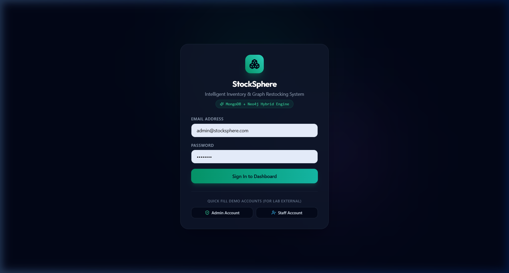
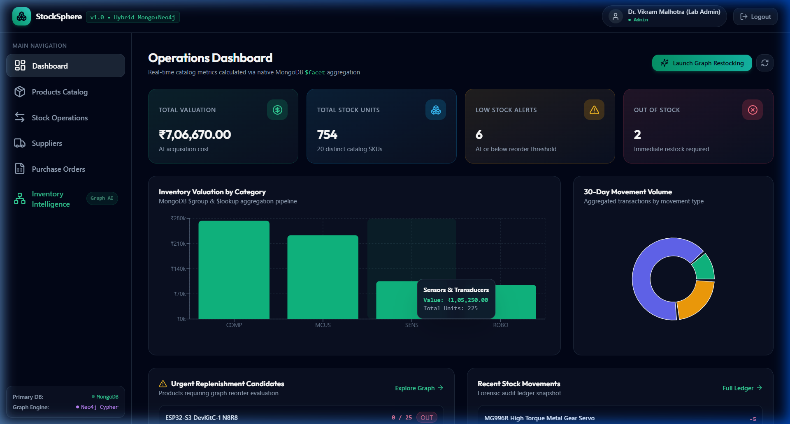
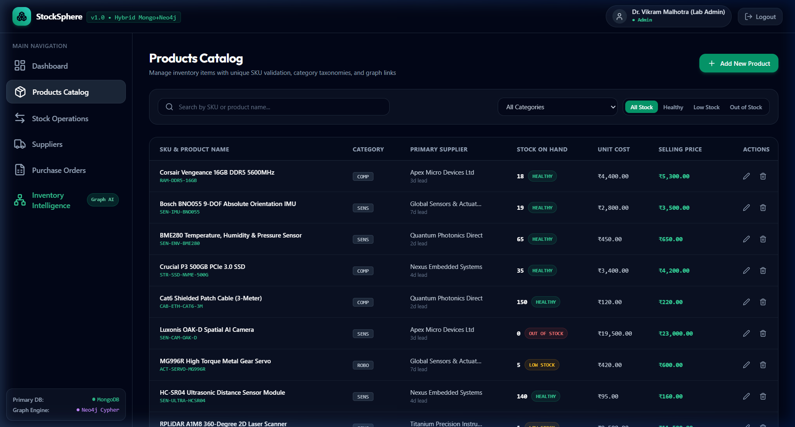
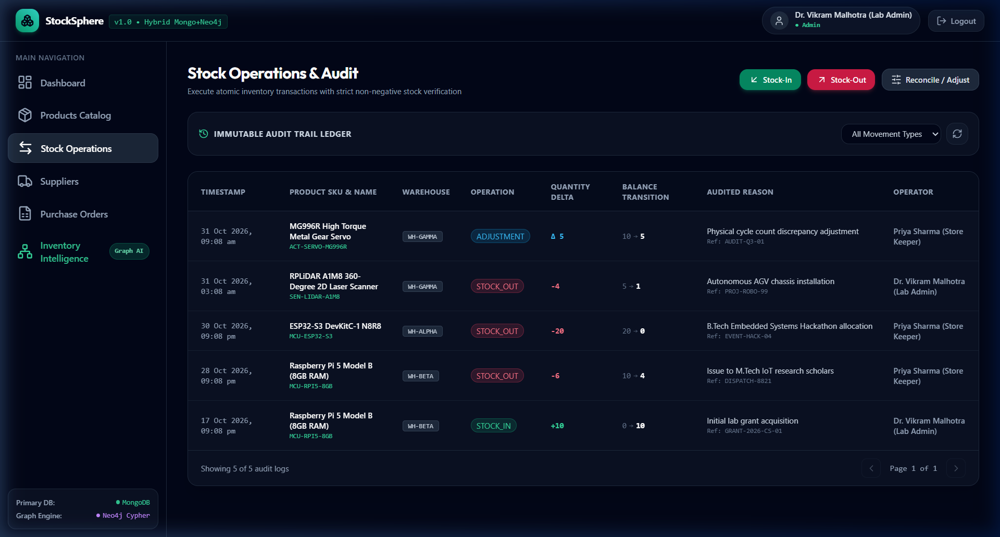
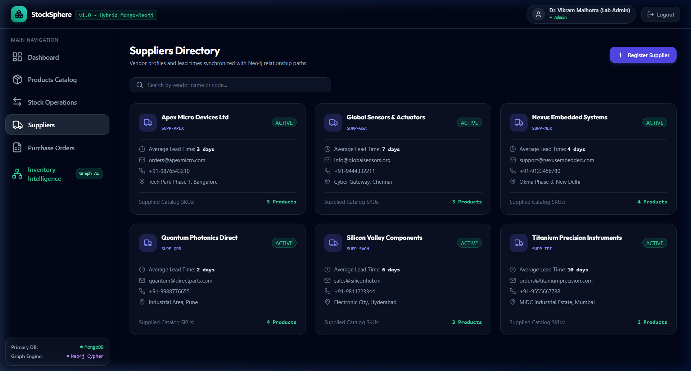
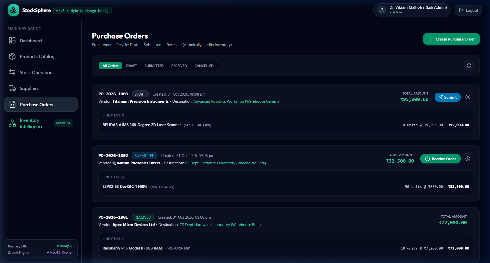
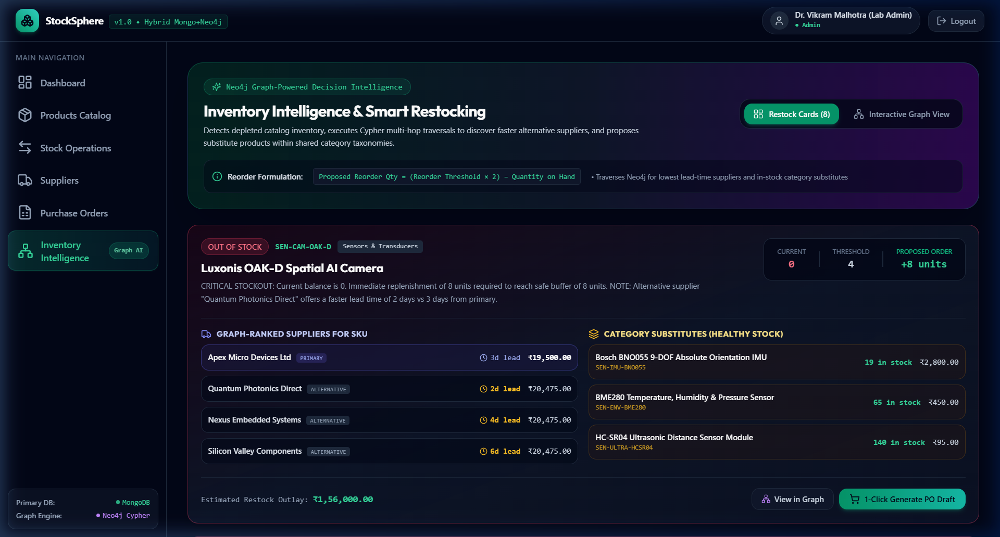

FINAL PROJECT
TECHNICAL REPORT

INTELLIGENT INVENTORY MANAGEMENT
& SUPPLY CHAIN KNOWLEDGE GRAPH SYSTEM

STOCKSPHERE

A polyglot-persistence application using MongoDB and Neo4j

| PROJECT TYPE | NoSQL Laboratory – Final Project |
| --- | --- |
| STUDENT ROLL NO | 23VV1A0615 |
| INSTITUTION | Department of CSE – JNTUGV Vizianagaram |
| TECHNOLOGY STACK | Node.js 18 • Express.js 4 • React 18 • Vite • MongoDB • Neo4j |
| USER INTERFACE | React SPA with Tailwind CSS, Recharts, @xyflow/react Graph Canvas |
| PROJECT STATUS | Working demonstration with automated database seeding |
| DOCUMENT TYPE | Final Project Technical Documentation |

SUBMITTED AS THE FINAL PROJECT DOCUMENTATION

---

# CONTENTS

1. Abstract

2. Technology Used

3. System Architecture

4. Flow Diagrams

5. NoSQL Databases Used

6. Inventory Intelligence Engine

7. Application Walkthrough

8. Appendix A — Source Reference Map

## Project Overview

This report documents the design, implementation, data architecture, operational workflows, security controls, and graph intelligence engine of StockSphere. The technical descriptions and implementation details are derived from the actual source code and reorganized for formal academic submission.

---

# 1. Abstract

This project implements an enterprise-grade intelligent inventory management system with a supply chain knowledge graph, built as a demonstration of polyglot persistence: two NoSQL databases, each performing the job it is genuinely best at, with clearly documented synchronization and fallback semantics.

**MongoDB (authoritative store)** owns every piece of truth: users and authentication, the product catalogue of 20 real-world electronics and IoT components (Raspberry Pi boards, ESP32 microcontrollers, RPLiDAR scanners, IMU sensors, servo motors, etc.), SKU classification with 4 categories (Microcontrollers & SBCs, Sensors & Transducers, Actuators & Motion, Networking & Communication), 6 vendors with lead-time profiles, 3 physical warehouse allocations, stock-on-hand balances, reorder thresholds, the complete stock movement audit trail (STOCK_IN, STOCK_OUT, ADJUSTMENT), and the full purchase order procurement lifecycle (DRAFT → SUBMITTED → RECEIVED → CANCELLED).

**Neo4j (derived graph projection)** mirrors the same domain as a traversal-friendly property graph — `Product`, `Supplier`, `Category`, and `Warehouse` nodes connected by `SUPPLIES`, `BELONGS_TO`, and `STORED_IN` relationships — and is used exclusively for supply chain intelligence: multi-hop Cypher traversals that discover alternative vendors with faster lead times, identify single points of failure in the supply chain, and propose category-based substitute SKUs when primary items are out of stock.

The write path follows one core design principle: **Mongo first, graph best-effort.** Every mutation commits to MongoDB, then fires a best-effort `MERGE` into Neo4j. If the graph database is unavailable, nothing else breaks — the intelligence module degrades transparently to a MongoDB-only fallback using the authoritative in-memory graph engine, and the projection can be rebuilt at any time with the `syncGraph.js` reconciliation script. The system never reports a failed graph write as success.

Stock operations (STOCK_IN, STOCK_OUT, ADJUSTMENT) are race-safe without multi-document transactions: the non-negative inventory invariant is enforced by a single conditional atomic update (`findOneAndUpdate` with `{quantityOnHand: {$gte: quantity}}` guard on STOCK_OUT), which is honest about what MongoDB guarantees on its deployment tiers. Two concurrent operators cannot both succeed on the same insufficient balance; the loser receives a clear, specific error with current stock figures.

Two roles use the system: **Admin** (full catalogue maintenance, supplier registration, warehouse management, purchase order lifecycle, stock operations, dashboard analytics, and graph intelligence) and **Inventory Staff** (stock operations, catalogue browsing, and movement audit trail). Security includes bcrypt-hashed passwords, JWT Bearer token authentication, server-side role guards via `protect` and `requireRole` middleware, Helmet HTTP security headers, and parameterized Cypher (no string interpolation in graph queries).

**Keywords:** NoSQL, MongoDB, Neo4j, polyglot persistence, Express.js, React, supply chain intelligence, graph traversal, conditional-update stock claims, eventual consistency with labeled fallback, inventory management, knowledge graph.

---

## 1.1 Project Overview

A React + Express.js web application ("StockSphere") where administrators manage a product catalogue of real electronics inventory items identified by unique SKU codes, track stock balances across multiple warehouses with configurable reorder thresholds, execute atomic stock-in/stock-out/adjustment operations logged to an immutable audit trail, manage a directory of vendors with lead-time and minimum-order metadata, run the full purchase order procurement lifecycle (draft, submit, receive with automatic inventory credit), and access a graph-powered Inventory Intelligence module that detects depleted inventory, executes Cypher multi-hop traversals to discover faster alternative suppliers, proposes substitute SKUs within shared category taxonomies, and renders the entire supply chain as an interactive React Flow topology canvas with live search, alert filters, and path isolation.

---

# 2. Technology Used

## 2.1 Core Stack

| Layer | Technology | Purpose |
| :--- | :--- | :--- |
| **Frontend Framework** | React 18.3 | Component-based single-page application |
| **Build Tool** | Vite 5.2 | HMR dev server with `/api` proxy to backend |
| **Styling** | Tailwind CSS 3.4 | Utility-first responsive design system |
| **Icons** | Lucide React 0.383 | Consistent SVG icon library |
| **Charts** | Recharts 2.12 | Dashboard analytics visualizations |
| **Graph Canvas** | @xyflow/react 12.0 | Interactive supply chain topology visualization |
| **HTTP Client** | Axios 1.7 | API communication with JWT interceptors |
| **Routing** | React Router DOM 6.23 | Client-side SPA routing with protected guards |
| **Backend Runtime** | Node.js 18+ | Server-side JavaScript execution |
| **API Framework** | Express.js 4.19 | RESTful API server with middleware pipeline |
| **Security Headers** | Helmet 7.1 | HTTP security header configuration |
| **Request Logging** | Morgan 1.10 | Development request logger |
| **Authentication** | JSON Web Tokens (jsonwebtoken 9.0) | Stateless Bearer token authentication |
| **Password Hashing** | bcryptjs 2.4 | Salted bcrypt hash (10 rounds) |
| **Validation** | express-validator 7.1 | Server-side request body validation |

## 2.2 Databases and Persistence Architecture

| Database | Mode | Content | Why This Database |
| :--- | :--- | :--- | :--- |
| **MongoDB** (or `mongodb-memory-server` offline) | Document store | `users`, `products`, `categories`, `suppliers`, `warehouses`, `stockmovements`, `purchaseorders` — 7 Mongoose collections | Flexible document model for catalogue metadata + transactional stock operations; unique indexes enforce SKU/email invariants; conditional atomic updates (`$inc` with `$gte` guard) replace multi-document transactions |
| **Neo4j Bolt** (optional in demo) | Property graph | 4 node labels (`Product`, `Supplier`, `Category`, `Warehouse`) + 3 relationship types (`SUPPLIES`, `BELONGS_TO`, `STORED_IN`) | Multi-hop traversals ("suppliers connected to this product via graph edges, ranked by lead time") are a natural Cypher query; awkward as MongoDB aggregations or self-joins |
| **mongodb-memory-server** | In-memory mock | Same schema as MongoDB | Zero-config demo portability — no external MongoDB daemon needed; documented trade-off: ephemeral per-process |
| **In-Memory Graph Engine** | Authoritative fallback | `graphStore.nodes` (Map) + `graphStore.edges` (Array) | When Neo4j daemon is not running, the dual-mode engine provides identical graph traversal semantics in-process |

---

# 3. System Architecture

## 3.1 System Context

Express.js is the single API server process; the React SPA (served by Vite dev server or static build) talks to it over HTTP with JWT Bearer tokens in the `Authorization` header; the backend talks to MongoDB over the Mongoose driver and Neo4j over the Bolt protocol (`neo4j-driver`). The Vite dev server proxies `/api/*` requests to `localhost:5000` to avoid CORS in development. Maintenance scripts (`seed.js`, `syncGraph.js`) complete the picture.

## 3.2 Container / Process Internal View

The architecture follows a clean separation: **Routes → Controllers → Services → Models**. There is no ORM abstraction layer beyond Mongoose schemas — raw aggregation pipelines (`$facet`, `$group`, `$lookup`, `$unwind`) power the dashboard analytics, making the document model visible and explicit everywhere. This is intentional for a NoSQL lab so students can see exactly what MongoDB does.

The API is versioned under `/api/v1/` with 9 route modules:

```
/api/v1/auth          → Authentication (login, register)
/api/v1/dashboard     → Analytics aggregation pipelines
/api/v1/products      → Product CRUD with graph sync
/api/v1/suppliers     → Supplier directory management
/api/v1/warehouses    → Warehouse registry
/api/v1/categories    → Category taxonomy
/api/v1/inventory     → Atomic stock operations (in/out/adjust)
/api/v1/purchase-orders → Procurement lifecycle
/api/v1/intelligence  → Graph-powered restock recommendations + topology
```

## 3.3 Module Map

```
stocksphere/
├── client/                          # Vite + React 18 Frontend
│   ├── src/
│   │   ├── api/
│   │   │   └── client.js            # Axios instance with JWT interceptors
│   │   ├── components/
│   │   │   ├── common/
│   │   │   │   ├── Navbar.jsx       # Top navigation bar
│   │   │   │   └── Sidebar.jsx      # Side navigation with route links
│   │   │   └── graph/
│   │   │       ├── SupplyChainGraph.jsx  # React Flow canvas orchestrator
│   │   │       ├── CustomNodes.jsx       # Product/Supplier/Category/Warehouse nodes
│   │   │       └── NodeDetailDrawer.jsx  # Slide-out detail panel on node click
│   │   ├── context/
│   │   │   └── AuthContext.jsx      # JWT session management + protected route logic
│   │   ├── pages/
│   │   │   ├── LoginPage.jsx        # Authentication with Quick Fill demo buttons
│   │   │   ├── DashboardPage.jsx    # Analytics dashboard with aggregation-driven metrics
│   │   │   ├── ProductsPage.jsx     # Product catalogue CRUD
│   │   │   ├── StockMovementsPage.jsx  # Stock operations + immutable audit trail
│   │   │   ├── SuppliersPage.jsx    # Supplier directory management
│   │   │   ├── PurchaseOrdersPage.jsx  # Procurement lifecycle (Draft→Submitted→Received)
│   │   │   └── IntelligencePage.jsx # Graph intelligence + interactive topology canvas
│   │   └── utils/
│   │       └── formatters.js        # Currency and number formatters
│   ├── vite.config.js               # Dev server with /api proxy to backend
│   └── tailwind.config.js           # Design system configuration
├── server/                          # Express.js Backend
│   ├── scripts/
│   │   ├── seed.js                  # Baseline database seeding (20 products, 6 suppliers, etc.)
│   │   └── syncGraph.js             # Graph reconciliation script (rebuild from MongoDB)
│   ├── src/
│   │   ├── config/
│   │   │   ├── db.js                # MongoDB connection with automatic in-memory fallback
│   │   │   └── neo4j.js             # Neo4j Bolt driver + in-memory graph engine
│   │   ├── controllers/
│   │   │   ├── authController.js    # Login/register with JWT issuance
│   │   │   ├── dashboardController.js  # $facet aggregation pipeline analytics
│   │   │   ├── productController.js # Product CRUD with graph sync on write
│   │   │   ├── supplierController.js   # Supplier CRUD with graph sync
│   │   │   ├── warehouseController.js  # Warehouse registry management
│   │   │   ├── categoryController.js   # Category taxonomy management
│   │   │   ├── stockController.js      # Atomic stock-in/out/adjust operations
│   │   │   ├── purchaseOrderController.js # PO lifecycle + automatic inventory credit
│   │   │   └── intelligenceController.js  # Graph intelligence API endpoints
│   │   ├── middleware/
│   │   │   ├── auth.js              # JWT protect + requireRole guards
│   │   │   ├── errorHandler.js      # Centralized error handling
│   │   │   └── validator.js         # express-validator middleware
│   │   ├── models/                  # Mongoose Schemas
│   │   │   ├── User.js              # (name, email, passwordHash, role, isActive)
│   │   │   ├── Product.js           # (sku, name, category, primarySupplier, ...)
│   │   │   ├── Category.js          # (name, code, description, isActive)
│   │   │   ├── Supplier.js          # (name, code, leadTimeDays, status, ...)
│   │   │   ├── Warehouse.js         # (name, code, location, capacityUnits)
│   │   │   ├── StockMovement.js     # (product, warehouse, user, movementType, ...)
│   │   │   └── PurchaseOrder.js     # (orderNumber, supplier, items[], totalAmount, ...)
│   │   ├── routes/                  # Express route definitions (9 modules)
│   │   └── services/
│   │       ├── stockService.js         # Atomic stock operations with non-negative enforcement
│   │       ├── graphSyncService.js     # MongoDB to Neo4j dual-mode synchronization
│   │       └── intelligenceService.js  # Restock recommendations + supply chain graph builder
│   └── package.json
├── package.json                     # Monorepo root scripts
├── start-all.bat                    # 1-Click Windows batch launcher
└── README.md
```

## 3.4 Request Guard Flow (Every Protected Endpoint)

Every protected route passes through the `protect` middleware → `requireRole(...)` middleware chain:

```
Incoming Request
     │
     ▼
┌─────────────────────────────┐
│  Extract Bearer Token from  │
│  Authorization Header       │
└──────────┬──────────────────┘
           │
     ┌─────▼──────┐
     │ Token      │──── NO ────► 401 "Authentication token required"
     │ Present?   │
     └─────┬──────┘
           │ YES
     ┌─────▼──────────────┐
     │ jwt.verify(token,  │──── INVALID ──► 401 "Invalid or expired token"
     │   JWT_SECRET)      │
     └─────┬──────────────┘
           │ VALID
     ┌─────▼──────────────────┐
     │ User.findById(decoded) │──── NOT FOUND / INACTIVE ──► 401 "Account not found"
     └─────┬──────────────────┘
           │ FOUND & ACTIVE
     ┌─────▼──────────────────┐
     │ requireRole Check      │──── UNAUTHORIZED ROLE ──► 403 "Forbidden: Requires [role]"
     │ (Admin / InventoryStaff)│
     └─────┬──────────────────┘
           │ AUTHORIZED
           ▼
     Controller Logic Executes
```

---

# 4. Flow Diagrams

## 4.1 Read Path — Dashboard Analytics Pipeline

The dashboard executes four MongoDB aggregation pipelines in a single API call, demonstrating advanced document-store querying:

```
GET /api/v1/dashboard
     │
     ▼
┌────────────────────────────────────────────────────────┐
│ Pipeline 1: $facet (Single-Pass Multi-Metric)          │
│   ├── overallMetrics: $group → totalProducts,          │
│   │    totalStockUnits, totalInventoryValuation,       │
│   │    potentialRevenue, outOfStockCount, lowStockCount │
│   └── lowStockCandidates: $match → $sort → $limit 5   │
├────────────────────────────────────────────────────────┤
│ Pipeline 2: Category Distribution                      │
│   $group by category → $lookup('categories') → $unwind │
│   → totalUnits, totalValue, productCount per category  │
├────────────────────────────────────────────────────────┤
│ Pipeline 3: Movement Trends (30-day window)            │
│   $match(timestamp >= 30d ago) → $group by movementType│
│   → totalUnits + transactionCount per type             │
├────────────────────────────────────────────────────────┤
│ Pipeline 4: Recent Movements (Top 6)                   │
│   .find().sort({timestamp: -1}).limit(6)               │
│   .populate('product','warehouse','user')              │
└────────────────────────────────────────────────────────┘
     │
     ▼
  JSON Response: { summary, categoryDistribution,
                   movementSummary, recentMovements,
                   urgentReplenishment }
```

## 4.2 Write Path — Atomic Stock-Out Operation

The critical transition is guarded by a single atomic conditional update: `findOneAndUpdate({_id, isArchived: false, quantityOnHand: {$gte: quantity}}, {$inc: {quantityOnHand: -quantity}})` — two racing operators cannot both win; the loser receives clean, specific errors with current balance figures.

```
POST /api/v1/inventory/stock-out
     │
     ▼
┌─────────────────────────────────────────────────────────┐
│ 1. Validate quantity > 0                                │
├─────────────────────────────────────────────────────────┤
│ 2. ATOMIC CONDITIONAL UPDATE (single MongoDB operation) │
│    findOneAndUpdate(                                    │
│      { _id: productId,                                  │
│        isArchived: false,                               │
│        quantityOnHand: { $gte: quantity } },  <-- GUARD │
│      { $inc: { quantityOnHand: -quantity } },           │
│      { new: true }                                      │
│    )                                                    │
│                                                         │
│    ┌─ Returns null? ──► Check WHY:                      │
│    │   • Product not found → 404                        │
│    │   • Product archived → 400                         │
│    │   • Insufficient stock → 400 with exact balance    │
│    │     "Requested X units, but only Y available"      │
│    │                                                    │
│    └─ Returns updated doc? ──► SUCCESS ──┐              │
├──────────────────────────────────────────┤              │
│ 3. Record immutable StockMovement audit entry:          │
│    { movementType: 'STOCK_OUT',                         │
│      previousQuantity, newQuantity,                     │
│      quantity, reason, user, timestamp }                │
├─────────────────────────────────────────────────────────┤
│ 4. ASYNC graph sync (fire-and-forget):                  │
│    graphSyncService.updateProductStock(...)              │
│    .catch() → logs warning, does NOT fail the operation │
└─────────────────────────────────────────────────────────┘
```

**Notes:**

The non-negative inventory invariant (`quantityOnHand >= 0`) is enforced by the `$gte` guard in the atomic conditional update — this is MongoDB's sweet spot for single-document race safety. Multi-document ACID transactions are not required because the critical constraint spans a single document. After the MongoDB commit succeeds, the graph stock level update runs asynchronously; if Neo4j is down, the stock operation still succeeds instantly and the graph can be reconciled later.

## 4.3 Purchase Order State Machine

```
    ┌────────┐      Submit      ┌───────────┐      Receive      ┌──────────┐
    │  DRAFT │ ───────────────► │ SUBMITTED │ ──────────────────► │ RECEIVED │
    └────┬───┘                  └─────┬─────┘                    └──────────┘
         │                            │                          (terminal: auto
         │  Cancel                    │  Cancel                   credits inventory
         ▼                            ▼                           for each line item)
    ┌───────────┐              ┌───────────┐
    │ CANCELLED │              │ CANCELLED │
    └───────────┘              └───────────┘
    (terminal)                 (terminal)
```

- **DRAFT**: Initial state. Order can be edited, submitted, or cancelled.
- **SUBMITTED**: Order sent to vendor. Can be received or cancelled.
- **RECEIVED**: Terminal state. Triggers automatic `STOCK_IN` for every line item via `stockService.stockIn()`. Each item's `orderedQuantity` is atomically credited to the product's `quantityOnHand` and an immutable audit movement is recorded.
- **CANCELLED**: Terminal state. No inventory effect.

Receiving an already-received order is explicitly guarded: *"Duplicate Action Prevented: This order has already been received and credited to inventory."*

## 4.4 Stock Movement Types

Stock movement records are **never deleted** — they form an append-only immutable audit trail. Every movement captures `previousQuantity → newQuantity` with the signed `quantity` delta, enabling complete forensic reconstruction of inventory history.

| Movement Type | Trigger | Effect on `quantityOnHand` | Audit Fields |
| :--- | :--- | :--- | :--- |
| `STOCK_IN` | Manual replenishment or PO receipt | `+quantity` via `$inc` | reason, referenceNumber (PO number) |
| `STOCK_OUT` | Dispatch, allocation, consumption | `-quantity` via conditional `$inc` with `$gte` guard | reason, referenceNumber |
| `ADJUSTMENT` | Cycle count discrepancy, correction | `$set` to target quantity | reason (mandatory), delta computed |

---

# 5. NoSQL Databases Used

## 5.1 Polyglot Persistence — Two Databases, Two Jobs

| Aspect | MongoDB (Authoritative) | Neo4j (Projection) |
| :--- | :--- | :--- |
| **Role** | Source of truth for the entire inventory system | Read-optimized shadow for supply chain intelligence traversal |
| **Model** | Documents (BSON), 7 Mongoose collections | Property graph, 4 node labels, 3 relationship types |
| **Writes** | Every mutation, always | Best-effort `MERGE` (idempotent), often asynchronous |
| **Reads** | Everything | Only supply chain intelligence: alternative suppliers, category substitutes, topology graph |
| **Uniqueness** | Unique indexes on `sku`, `email`, `orderNumber`, `code` fields | `CREATE CONSTRAINT ... IS UNIQUE` on `mongoId` for all 4 labels |
| **Recovery** | N/A (it is the truth) | Full rebuild from MongoDB via `syncGraph.js` |

## 5.2 Rationale for Selecting Two NoSQL Databases

**Product metadata is ragged by nature.** Real inventory items have variable descriptions, optional fields, and nested sub-documents (e.g., purchase order `items[]` arrays with per-line subtotals). MongoDB documents tolerate this structural flexibility per-item without requiring nullable columns or EAV tables in SQL.

**Stock operations are transaction-critical but narrow.** The single invariant that matters (a product's `quantityOnHand` can never go negative) is enforced by one atomic conditional update — MongoDB's sweet spot. Multi-document ACID transactions would demand replica-set deployment for marginal benefit at this scale.

**Supply chain intelligence is graph-shaped.** "Which suppliers can deliver this product, ranked by lead time, and what substitute products exist in the same category with healthy stock?" is a multi-hop traversal. In Neo4j this is one readable Cypher query; in SQL or MongoDB aggregation it would be a complex, nested pipeline of self-joins.

The databases operate within **independent failure domains**; the design does not claim cross-database atomicity. The design does not claim cross-database transactions: MongoDB commits first, graph sync is best-effort, and degradation is visible and handled.

## 5.3 MongoDB — Collections and Data Model

### 7 Mongoose Collections

| Collection | Key Fields | Indexes | Purpose |
| :--- | :--- | :--- | :--- |
| `users` | `name`, `email` (unique), `passwordHash`, `role` (Admin/InventoryStaff), `isActive` | email (unique) | Authentication and role-based access |
| `products` | `sku` (unique), `name`, `category` (ref), `primarySupplier` (ref), `defaultWarehouse` (ref), `unitCost`, `sellingPrice`, `quantityOnHand`, `reorderThreshold`, `isArchived` | sku (unique, text), category+isArchived, primarySupplier, defaultWarehouse, quantityOnHand+reorderThreshold, full-text (name, sku, description) | Core inventory catalogue |
| `categories` | `name` (unique), `code` (unique), `description`, `isActive` | name (unique), code (unique) | Product classification taxonomy |
| `suppliers` | `name` (unique), `code` (unique), `email`, `phone`, `address`, `leadTimeDays`, `minimumOrderQuantity`, `status` (ACTIVE/INACTIVE) | status+leadTimeDays | Vendor directory |
| `warehouses` | `name` (unique), `code` (unique), `location`, `managerName`, `capacityUnits` | name (unique), code (unique) | Physical storage locations |
| `stockmovements` | `product` (ref), `warehouse` (ref), `user` (ref), `movementType`, `quantity`, `previousQuantity`, `newQuantity`, `reason`, `referenceNumber`, `timestamp` | product+timestamp, warehouse+timestamp, movementType+timestamp, timestamp | Immutable audit trail |
| `purchaseorders` | `orderNumber` (unique), `supplier` (ref), `warehouse` (ref), `status`, `items[]` (embedded), `totalAmount`, `orderDate`, `expectedDeliveryDate`, `receivedDate`, `createdBy` (ref) | supplier+status, status+createdAt | Procurement lifecycle |

### Data-Modeling Techniques Showcased

- **Embedded sub-documents**: Purchase order `items[]` are embedded (not referenced) because line items have no independent lifecycle outside their parent order. Each item captures `product` (ref), `sku`, `productName`, `orderedQuantity`, `receivedQuantity`, `unitCost`, and `subtotal`.

- **Computed virtuals**: `Product` schema defines `isLowStock`, `isOutOfStock`, and `totalValue` as Mongoose virtuals — computed on access, never stored, always consistent with the underlying `quantityOnHand` and `reorderThreshold` fields.

- **Pre-save hooks**: Password hashing is handled by a Mongoose `pre('save')` hook that runs `bcrypt.genSalt(10)` + `bcrypt.hash()` only when `passwordHash` is modified. The `passwordHash` field is excluded from default queries via `select: false`.

- **Conditional atomic updates**: `stockOut()` uses `findOneAndUpdate` with a `{quantityOnHand: {$gte: quantity}}` match condition — this is the honest, race-safe way to enforce non-negative inventory without multi-document transactions.

- **Aggregation pipelines**: The dashboard uses `$facet` for single-pass multi-metric computation, `$group` + `$lookup` + `$unwind` for category distribution breakdown, and time-windowed `$match` for 30-day movement trends.

## 5.4 Neo4j — Graph Schema

### Node Labels

| Label | Unique Constraint | Key Properties |
| :--- | :--- | :--- |
| `Product` | `mongoId IS UNIQUE` | `sku`, `name`, `quantityOnHand`, `reorderThreshold`, `unitCost`, `sellingPrice`, `isLowStock` |
| `Supplier` | `mongoId IS UNIQUE` | `name`, `code`, `leadTimeDays`, `status` |
| `Category` | `mongoId IS UNIQUE` | `name`, `code`, `isActive` |
| `Warehouse` | `mongoId IS UNIQUE` | `name`, `code`, `location` |

### Relationship Types

| Relationship | Direction | Properties | Semantics |
| :--- | :--- | :--- | :--- |
| `SUPPLIES` | `(Supplier)-[:SUPPLIES]->(Product)` | `isPrimary`, `leadTimeDays`, `unitCost` | Vendor-to-product supply link; primary and alternative |
| `BELONGS_TO` | `(Product)-[:BELONGS_TO]->(Category)` | — | Product classification |
| `STORED_IN` | `(Product)-[:STORED_IN]->(Warehouse)` | — | Physical storage allocation |

### The Candidate Query (What the Graph Is For)

**Alternative supplier discovery** — "Which active suppliers can supply this product, ranked by lead time?":

```cypher
MATCH (p:Product { mongoId: $pId })
MATCH (s:Supplier)-[r:SUPPLIES]->(p)
WHERE s.status = 'ACTIVE'
RETURN s.mongoId AS supplierId,
       s.name AS supplierName,
       COALESCE(r.leadTimeDays, s.leadTimeDays) AS leadTimeDays,
       COALESCE(r.unitCost, p.unitCost) AS unitCost,
       COALESCE(r.isPrimary, false) AS isPrimary
ORDER BY isPrimary DESC, leadTimeDays ASC
```

**Category substitute discovery** — "What other products in the same category have healthy stock?":

```cypher
MATCH (target:Product { mongoId: $pId })-[:BELONGS_TO]->(c:Category)
MATCH (sub:Product)-[:BELONGS_TO]->(c)
WHERE sub.mongoId <> $pId AND sub.quantityOnHand > sub.reorderThreshold
OPTIONAL MATCH (s:Supplier)-[r:SUPPLIES]->(sub)
RETURN sub.mongoId AS substituteProductId,
       sub.sku AS sku, sub.name AS name,
       sub.quantityOnHand AS availableStock,
       sub.unitCost AS unitCost,
       c.name AS categoryName,
       s.name AS supplierName
ORDER BY sub.quantityOnHand DESC
LIMIT 3
```

Every Cypher statement is **parameterized** (no string interpolation) — injection-safe by construction.

## 5.5 MongoDB to Neo4j Correspondence

| MongoDB Fact | Graph Fact |
| :--- | :--- |
| `products.category` (ObjectId ref) | `(Product)-[:BELONGS_TO]->(Category)` |
| `products.primarySupplier` (ObjectId ref) | `(Supplier)-[:SUPPLIES {isPrimary: true}]->(Product)` |
| `products.defaultWarehouse` (ObjectId ref) | `(Product)-[:STORED_IN]->(Warehouse)` |
| Additional supplier links (via seed/graph sync) | `(Supplier)-[:SUPPLIES {isPrimary: false, leadTimeDays, unitCost}]->(Product)` |
| `products.quantityOnHand` | `Product.quantityOnHand` (synced on stock operations) |
| `products.reorderThreshold` | `Product.reorderThreshold` (synced on product update) |

## 5.6 Sync Strategy — Honesty About Consistency

The golden rule: **commit Mongo → best-effort graph merge → log warning on failure.**

- MongoDB is committed first, only after the business rule validates.

- Graph `MERGE`s are **idempotent** and safe to replay — MERGE semantics in Neo4j mean the same sync operation can run twice without creating duplicates.

- When the graph write fails (Neo4j unavailable), the `graphSyncService` catches the error and logs a warning via `console.warn`. The operation that triggered the sync **still succeeds** — the user's stock operation or product update is never rolled back due to a graph failure.

- Reads that need the graph (restock recommendations, alternative suppliers, topology canvas) **degrade transparently** to the authoritative in-memory graph engine (`graphStore.nodes` Map + `graphStore.edges` Array), which is kept in sync via the same `_updateMemoryEdge()` mechanism.

- `syncGraph.js` (maintenance script) rebuilds the complete graph projection from MongoDB at any time — products, categories, suppliers, warehouses, and all relationship edges.

---

# 6. Inventory Intelligence Engine

"Restock Recommendations & Supply Chain Topology" — deterministic, explainable, graph-powered.

## 6.1 Restock Recommendation Algorithm

The Intelligence Engine combines MongoDB low-stock detection with Neo4j relationship traversal:

### Step 1: Identify Low-Stock Products (MongoDB)

```javascript
Product.find({
  isArchived: false,
  $expr: { $lte: ['$quantityOnHand', '$reorderThreshold'] }
}).sort({ quantityOnHand: 1 })
```

### Step 2: Deterministic Reorder Formulation

```
Proposed Reorder Qty = (Reorder Threshold x 2) - Quantity on Hand
```

The target level is set to **twice the threshold** to provide a safety buffer. This ensures stock returns to a healthy level rather than just barely crossing the threshold.

### Step 3: Graph-Powered Supplier Discovery (Neo4j or In-Memory Fallback)

For each low-stock product, the engine executes:
- **Alternative supplier query**: Cypher multi-hop traversal finding all `SUPPLIES` edges, ranked by `leadTimeDays ASC`
- **Category substitute query**: Cypher traversal via shared `BELONGS_TO` → `Category` edges to find healthy-stock substitutes

### Step 4: Human-Readable Recommendation Generation

| Condition | Generated Reason String |
| :--- | :--- |
| `quantityOnHand === 0` | `CRITICAL STOCKOUT: Current balance is 0. Immediate replenishment of X units required to reach safe buffer of Y units.` |
| `quantityOnHand <= reorderThreshold` | `LOW STOCK ALERT: Available balance (X) is at or below threshold (Y). Restock of Z units recommended.` |
| Alternative supplier has faster lead time | `NOTE: Alternative supplier "Name" offers a faster lead time of A days vs B days from primary.` |

Each recommendation card displays: current stock, threshold, proposed reorder quantity, estimated total cost (`proposedReorderQuantity x unitCost`), urgency level (CRITICAL/HIGH), graph-ranked supplier list, and category substitutes with their available stock levels.

## 6.2 Supply Chain Topology Visualization

The `getSupplyChainGraph()` method builds a complete React Flow graph with:

- **Category nodes** (top row) — clustered with product counts and total valuation
- **Supplier nodes** (left column) — with lead time, status, and supplied SKU counts
- **Product nodes** (center, grouped by category columns) — with stock level, alert status, and alternative supplier annotations
- **Warehouse nodes** (right column) — with location and stored product counts

Edge types:
- `BELONGS_TO` (Product → Category) — animated when low stock or selected
- `SUPPLIES` (Supplier → Product) — color-coded: primary (indigo), alternative (yellow dashed)
- `STORED_IN` (Product → Warehouse) — pink, linking physical allocation

The topology is rendered using `@xyflow/react` with interactive features: live search filtering, restock alert isolation, supplier-link views, node click detail drawers, and full-screen mode.

---

# 7. Application Walkthrough

## 7.1 Authentication

The login page features one-click **Quick Fill** demo buttons for each role (Admin and Staff). Credentials are pre-populated by clicking the corresponding button, then the user clicks "Sign In." Authentication issues a JWT token stored in the React `AuthContext` and attached to all subsequent API requests as a Bearer token.

| Role | Email | Password |
| :--- | :--- | :--- |
| **Admin** | `admin@stocksphere.com` | `admin123` |
| **Inventory Staff** | `staff@stocksphere.com` | `staff123` |



## 7.2 Operations Dashboard

Real-time analytics dashboard powered by MongoDB `$facet`, `$group`, and `$lookup` aggregation pipelines. A single API call computes all metrics in one database round-trip.

**Top-level KPI cards**: Total Products, Total Stock Units, Inventory Valuation, Potential Revenue, Out of Stock Count, Low Stock Count, Healthy Stock Count, Active Suppliers, Active Warehouses, Pending Purchase Orders.

**Category distribution chart**: Recharts bar visualization showing units and valuation breakdown per category (Microcontrollers & SBCs, Sensors & Transducers, Actuators & Motion, Networking & Communication).

**30-day movement trends**: Aggregated STOCK_IN, STOCK_OUT, and ADJUSTMENT transaction counts and unit volumes.

**Recent movements rail**: Latest 6 stock movements with populated product names, warehouse codes, operator names, and balance transitions.

**Urgent replenishment table**: Top 5 products closest to or below their reorder threshold, sorted by ascending stock level.



## 7.3 Product Catalog

Full CRUD interface for the product inventory. Each product card shows: SKU, name, category, primary supplier, unit cost, selling price, quantity on hand, reorder threshold, stock status badge (Healthy / Low Stock / Out of Stock), and total inventory value.

Features:
- **Text search** across product name, SKU, and description using MongoDB full-text index
- **Category filter** dropdown
- **Stock status filter**: All / Healthy / Low Stock / Out of Stock
- **Add Product** modal with form validation
- **Edit / Archive** product actions
- **Graph sync on write**: Every product create/update triggers `graphSyncService.syncProduct()` to keep the Neo4j projection current



## 7.4 Stock Operations & Audit

Execute atomic stock transactions with strict non-negative verification. Three operation types:

- **Stock-In**: Add units to a product's balance (e.g., receiving goods, manual replenishment)
- **Stock-Out**: Remove units from a product's balance (guarded by `$gte` conditional check)
- **Reconcile / Adjust**: Set balance to an exact target quantity (for cycle count discrepancies)

**Immutable Audit Trail Ledger**: A forensic log showing every stock movement ever recorded. Each entry displays: timestamp, product SKU & name, warehouse code, operation type (color-coded: green for STOCK_IN, red for STOCK_OUT, amber for ADJUSTMENT), quantity delta (signed), balance transition (`previousQuantity → newQuantity`), audited reason, reference number, and operator name. Entries are paginated and filterable by movement type.



## 7.5 Suppliers Directory

Vendor profile management synchronized with Neo4j relationship paths. Each supplier card displays: name, vendor code, average lead time (days), contact email and phone, address, status (ACTIVE/INACTIVE), and count of supplied catalog SKUs.

Features:
- **Search** by vendor name or code
- **Register Supplier** with lead time and minimum order quantity
- **Edit supplier** details (graph sync on update)
- **Lead time visibility**: Critical for the intelligence engine's alternative supplier ranking



## 7.6 Purchase Orders

Procurement lifecycle management with automatic inventory credit on receipt.

**Lifecycle**: Draft → Submitted → Received (atomically credits inventory for each line item)

Each purchase order card shows: order number (auto-generated `PO-YYYY-NNNN`), status badge (DRAFT/SUBMITTED/RECEIVED/CANCELLED), vendor name, destination warehouse, creation date, line items with SKU, product name, ordered quantity, unit cost, and line subtotal, and total order amount.

**Key actions**:
- **Create Purchase Order**: Select supplier, warehouse, add line items from product catalog
- **Submit**: Move from DRAFT to SUBMITTED
- **Receive Order**: Triggers automatic `stockService.stockIn()` for every line item, atomically incrementing `quantityOnHand` and recording audit movements with the PO number as reference
- **Cancel**: Terminal state, no inventory effect

**Duplicate prevention**: Receiving an already-received order returns a clear *"Duplicate Action Prevented"* error.



## 7.7 Inventory Intelligence (Graph Engine)

The crown jewel of StockSphere — graph-powered decision intelligence for supply chain optimization.

### Restock Cards View

Detects depleted catalog inventory, executes Cypher multi-hop traversals to discover faster alternative suppliers, and proposes substitute products within shared category taxonomies.

Each restock recommendation card shows:
- **Product identity**: SKU, name, category badge, stock status (OUT OF STOCK / LOW STOCK)
- **Stock metrics**: Current balance, threshold, proposed reorder quantity (+X units)
- **Recommendation explanation**: Human-readable reason string (e.g., *"CRITICAL STOCKOUT: Current balance is 0. Immediate replenishment of 8 units required..."*)
- **Reorder formulation**: `Proposed Reorder Qty = (Reorder Threshold x 2) - Quantity on Hand`
- **Graph-ranked suppliers for SKU**: Primary supplier with lead time + alternative vendors discovered via graph traversal, sorted by lead time ascending
- **Category substitutes (healthy stock)**: Other products in the same category with stock above threshold
- **Estimated restock outlay**: Total cost calculation
- **1-Click Generate PO Draft**: Creates a purchase order directly from the recommendation
- **View in Graph**: Jumps to the topology canvas with this product highlighted

### Interactive Topology Canvas View

Full supply chain knowledge graph rendered as an interactive React Flow diagram:
- **33 nodes**: 20 Products (center), 6 Suppliers (left), 4 Categories (top), 3 Warehouses (right)
- **3 edge types**: SUPPLIES (primary: solid indigo, alternative: dashed yellow), BELONGS_TO (gray/red), STORED_IN (pink)
- **Live controls**: Search by SKU/product/supplier/warehouse, Restock Alerts filter (isolate low-stock paths), Suppliers & Links filter, Topology Insights dropdown
- **Node interaction**: Click any node to open a detail drawer with full metadata
- **Visual indicators**: Low-stock products pulsate with animated red edges; out-of-stock nodes highlighted

**Status bar**: Shows active database engines — `Primary DB: MongoDB` and `Graph Engine: Neo4j / Cypher` (or `In-Memory` when Neo4j is unavailable).



---

# 8. Appendix A — Source Reference Map

| Source File | Lines | Purpose |
| :--- | :--- | :--- |
| `server/src/server.js` | 102 | Express app bootstrap, middleware, route mounting, auto-seed |
| `server/src/config/db.js` | 50 | MongoDB connection with automatic in-memory fallback |
| `server/src/config/neo4j.js` | 83 | Neo4j Bolt driver + in-memory `graphStore` engine |
| `server/src/models/Product.js` | 95 | Product schema with virtuals, 5 indexes |
| `server/src/models/Supplier.js` | 62 | Supplier schema with `leadTimeDays` and status |
| `server/src/models/Warehouse.js` | 47 | Warehouse schema with `capacityUnits` |
| `server/src/models/Category.js` | 37 | Category taxonomy schema |
| `server/src/models/StockMovement.js` | 70 | Immutable audit trail schema, 4 compound indexes |
| `server/src/models/PurchaseOrder.js` | 114 | PO schema with embedded `items[]` sub-documents |
| `server/src/models/User.js` | 63 | User schema with `pre('save')` bcrypt hook |
| `server/src/services/stockService.js` | 155 | Atomic stock operations: stockIn, stockOut, stockAdjustment |
| `server/src/services/graphSyncService.js` | 328 | MongoDB to Neo4j dual-mode sync service |
| `server/src/services/intelligenceService.js` | 477 | Intelligence engine: restock recommendations + graph builder |
| `server/src/middleware/auth.js` | 65 | JWT `protect` + `requireRole` guard middleware |
| `server/src/controllers/dashboardController.js` | 172 | `$facet` aggregation pipeline analytics |
| `server/src/controllers/purchaseOrderController.js` | 181 | PO lifecycle with auto inventory credit on receive |
| `server/scripts/seed.js` | 500+ | Baseline seeding: 2 users, 4 categories, 6 suppliers, etc. |
| `server/scripts/syncGraph.js` | ~80 | Graph reconciliation: rebuild Neo4j from MongoDB |
| `client/src/App.jsx` | 113 | React SPA routing with ProtectedLayout guard |
| `client/src/pages/DashboardPage.jsx` | 500+ | Dashboard analytics with Recharts |
| `client/src/pages/IntelligencePage.jsx` | 700+ | Intelligence UI: restock cards + topology graph toggle |
| `client/src/pages/ProductsPage.jsx` | 800+ | Product catalog CRUD |
| `client/src/pages/StockMovementsPage.jsx` | 700+ | Stock operations + audit trail |
| `client/src/pages/PurchaseOrdersPage.jsx` | 700+ | PO lifecycle UI |
| `client/src/pages/SuppliersPage.jsx` | 400+ | Supplier directory |
| `client/src/components/graph/SupplyChainGraph.jsx` | ~300 | React Flow canvas orchestrator |
| `client/src/components/graph/CustomNodes.jsx` | ~200 | Custom node renderers |
| `client/src/components/graph/NodeDetailDrawer.jsx` | ~150 | Slide-out detail panel |

---

## Header and Footer Content

### Header

noSQL LAB – CSE JNTUGV Vizianagaram

### Footer

Roll No: 23VV1A0615                                        Intelligent Inventory Management & Supply Chain Knowledge Graph System

---

*Document generated from StockSphere source code analysis — 2026.*
